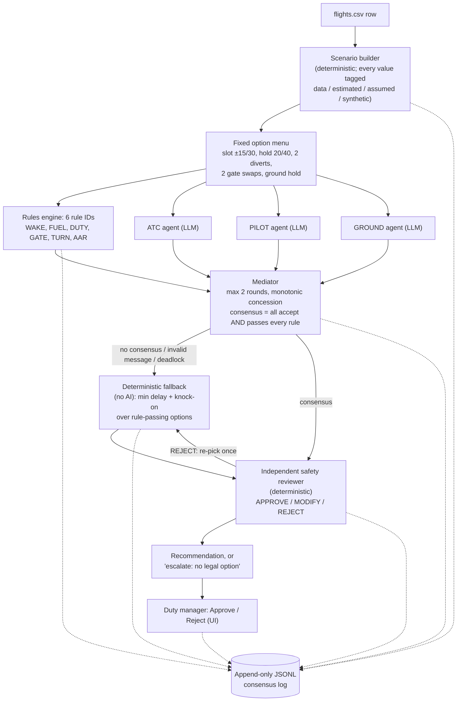

# SRRW Solutions: multi-agent disruption negotiation for airline operations

Three AI agents (ATC, Pilot, Ground) negotiate a fix for a weather-disrupted arrival over a fixed
menu of options. Deterministic code checks every option against six rules and makes the decision.
A human approves it.

**LLMs negotiate, code decides, every decision traces to a rule and a data field, and a human approves.**

Autonomous SG 2026, Airbus track, Challenge #2 (Multi-Agent Air Traffic Negotiation). Data: US DOT
2015 flight delays.

---

## The user and the problem

**User:** the airline operations-control **duty manager** during irregular operations. When weather
cuts a hub's arrival rate, they coordinate three parties who each own one part of the answer:

- **ATC:** the TRACON traffic manager (arrival slots, holding, wake spacing, arrival-rate caps).
- **The flight crew:** fuel, alternates and duty-time limits.
- **Ramp / gate control:** gates and the aircraft's next departure.

**Today** this is done by phone and manual system updates across three organisations, one call at a
time. While the calls go on, the delay spreads to the rest of the aircraft's day.

**A real example from the data:** aircraft N469AA, 24 Apr 2015, DFW's worst weather day in the file.
AA334 MFE→DFW arrived **+101 min** late (58 min weather, 43 min late aircraft). The same aircraft's
last leg that day, AA1274 DFW→BWI, arrived **+256 min** late. One disrupted arrival grew into a
four-hour delay by evening.

The tool produces a **recommendation** for the duty manager: one option from a fixed menu, with the
rule checks, data fields and source tags behind it. The duty manager approves or rejects it. The tool
never executes anything.

## How it works



1. **Scenario builder** (`src/scenario/`). Turns one `flights.csv` row into a `Scenario`: the
   flight, delayed arrivals in the destination hour, the aircraft's later legs that day, the nearest
   alternates, and estimated/synthetic state (fuel, crew duty, gates). Every number carries a source
   tag.
2. **Fixed option menu** (`src/options/`). About 11 candidates: `SLOT±15/30`, `HOLD20/40`,
   `DIVERT_<IATA>` to the two nearest alternates, two gate swaps, and a ground hold at origin. Each
   has a deterministic delay and knock-on estimate.
3. **Rules engine** (`src/rules/`). One `RuleResult` per (candidate, rule), each citing its source:

   | Rule ID | Check | Basis |
   |---|---|---|
   | `R-WAKE-01` | Per-runway arrival spacing vs wake separation | FAA JO 7110.65 5-5-4 (distances); runway count, leader, speed **assumed** |
   | `R-FUEL-01` | Fuel left after the option ≥ alternate + 45 min final reserve | 14 CFR 121.639; fuel **estimated** |
   | `R-DUTY-01` | Crew flight-duty period not exceeded at arrival | 14 CFR Part 117; duty state **synthetic** |
   | `R-GATE-01` | Assigned or swapped gate free for the turnaround | **synthetic** gate model |
   | `R-TURN-01` | Option adds ≤ 30 min to the next leg | **assumed** airline threshold |
   | `R-AAR-01` | Arrival demand under the weather-reduced arrival rate | **assumed** nominal rates |

4. **Three independent agents** (`src/agents/`). ATC, PILOT and GROUND are separate LLM calls with
   separate system prompts. Each sees only its own domain's data (`src/agents/views.py`). They never
   see the rule results or the real outcome. Each returns a schema-validated JSON message (acceptable
   set, ranking with cited fields, vetoes). An invalid reply is logged with its raw text and never
   repaired. There is one content retry, then the message counts as invalid.
5. **Mediator** (`src/mediator/`). Runs at most 2 rounds ("under 3 turns"; the fallback is turn 3).
   Monotonic concession: an agent's round-2 acceptable set must contain its round-1 set. Consensus is
   an option that all three accept **and** that passes every rule. Ties go to the highest summed
   score.
6. **Deterministic fallback** (`src/fallback/`, no AI). It fires on no consensus, an invalid message,
   a deadlock or a reviewer REJECT. It picks the rule-passing option with the lowest
   `delay + knock-on` and ignores agent opinions. If no option passes, it returns nothing, which means
   "escalate to a human".
7. **Independent safety reviewer** (`src/reviewer/`, deterministic). Written separately from the
   rules engine. It re-derives FUEL, DUTY and WAKE from the raw scenario and checks every value an
   agent cited against the scenario.
   - **REJECT** if the pick fails any check, or if there is no pick. The fallback then re-picks once
     without the rejected option. If that is also rejected, or nothing is eligible, the run escalates
     to the duty manager.
   - **MODIFY** if it finds a discrepancy a human should look at (engine disagreement, a mismatched
     cited value, a delay estimate that is off).
   - Otherwise **APPROVE**.
8. **Consensus log** (`src/log/`). Append-only, timestamped JSONL: every agent message, invalid
   reply, rule check, intersection, fallback (and why), reviewer verdict and human decision.
9. **Human approval** (`app/`). A Streamlit UI shows the scenario with source tags, each round, the
   rule matrix, the reviewer's re-derivation and the recommendation. The duty manager clicks Approve
   or Reject, and that is written to the log.

**LLM / non-LLM split.**

- LLMs only rank, veto and explain options from their own domain's view.
- All arithmetic, scheduling, legality and safety logic (separation, fuel, duty time, gates, delay
  estimates, the final pick) is plain Python in `src/rules/`, `src/options/`, `src/fallback/` and
  `src/reviewer/`.
- No prompt asks a model to compute or judge legality.
- The whole pipeline also runs with no LLM at all (`--agents stub` or `--agents none`).

## Quick start

Requires **Python ≥ 3.11** (tested on 3.14.7). The data (`data/flights.csv`, 39 MB) is in the repo.

```bash
pip install -r requirements.txt
cp .env.example .env          # PowerShell: Copy-Item .env.example .env
# then edit .env:  ANTHROPIC_API_KEY=sk-ant-...   (only needed for --agents haiku / sonnet)
```

```bash
# Tests (no API key needed)
pytest -q

# Showcase: AA334 MFE->DFW, 24 Apr 2015 (row 123017), live Claude Haiku agents
python -m src.cli --row-id 123017 --agents haiku --pretty

# Failure demo: forced deadlock -> the deterministic fallback decides (no API key needed)
python -m src.cli --row-id 123017 --agents stub --force-deadlock --out runs/deadlock/ --pretty

# Solver-only baseline: no agents, the fallback picks (no API key needed)
python -m src.cli --row-id 123017 --agents none --pretty

# Stub agents: deterministic heuristics, no API key needed
python -m src.cli --row-id 123017 --agents stub --pretty

# The real failure case from docs/failure_case.md (every option fails crew duty -> escalate)
python -m src.cli --row-id 352317 --agents stub --pretty

# Evaluation: 200 seeded rows, solver-only + Haiku agents (hard budget cap, default $15)
python -m eval.run_eval --n 200 --seed 42 --agents haiku --out eval/results/ --deadline none

# UI
streamlit run app/streamlit_app.py
```

Each CLI run writes `runs/<scenario_id>.json` (scenario, candidates, rule results, turns,
recommendation, reviewer detail) and appends to `runs/<scenario_id>.jsonl` (the consensus log).

`--deadline none` turns off the eval's wall-clock guard, which defaults to 15:05 on event day. Start
with `--n 10` to measure cost. Use `--agents stub --out eval/results_stub/` to run the harness with no
API key.

**`runs/` holds pre-computed demo runs, so the UI works without an API key:**

| File | What it is |
|---|---|
| `runs/2015-04-24_AA334_N469AA.json` | AA334 with Haiku agents |
| `runs/live/2015-04-24_AA334_N469AA.json` | AA334 with Sonnet agents |
| `runs/deadlock/2015-04-24_AA334_N469AA.json` | AA334 forced deadlock |
| `runs/failure_showcase.json` | DL1501 escalation (Haiku) |

In the UI sidebar, **Showcase AA334** and **Failure case** load these directly.

## Results

### Evaluation (200 real delayed flights, Claude Haiku 5.5 agents)

| Metric | Value |
|---|---|
| Consensus rate (within 2 rounds) | TBD |
| Consensus in round 1 | TBD |
| Agent top picks breaking a rule they could not see | TBD |
| Agreed options excluded by the rules | TBD |
| Escalated to a human (no legal option) | TBD |
| Reviewer APPROVE / MODIFY / REJECT | TBD |
| Reviewer-engine disagreement | TBD |
| Schema-invalid replies | TBD |
| Fallback after an invalid reply | TBD |
| Agents vs solver-only: same pick | TBD |
| Cost per decision | TBD |
| Latency per decision | TBD |

Full numbers and definitions are in [`eval/results/summary.md`](eval/results/summary.md). The
per-row results are in `eval/results/per_scenario.csv`. The sample is 150 weather-delayed arrivals
into ORD/ATL/DFW/DEN plus 50 late-aircraft rows, seed 42, with IDs saved in `eval/sample_ids.csv`.
Every row is also run solver-only for comparison.

**Modelled delays are model estimates, not measured outcomes.** The tool's delay figures come from
the option menu's deterministic model. They are not comparable like-for-like with the real
`ARRIVAL_DELAY` in the data, and no saving is claimed as measured.

## Where it fails (honest evaluation)

See **[docs/failure_case.md](docs/failure_case.md)**.

In the showcase (DL1501 BOS→ATL, 29 Dec 2015, row 352317, saved in `runs/failure_showcase.json`),
the three Haiku agents agreed on 8 of 11 options. Every option fails crew duty (`R-DUTY-01`), because
the synthetic duty state leaves 103 min at scheduled arrival and the flight is already 256 min late.
So the mediator finds no consensus, the fallback has nothing legal, and the reviewer REJECTs. The UI
shows "No option passes engine and reviewer — escalate to duty manager" under a red fallback banner.

Known failure modes:

- **Synthetic crew duty drives most escalations.** After calibration, 27 of 200 sample rows have no
  option that passes every rule, and on 22 of them `R-DUTY-01` fails every option
  ([docs/calibration.md](docs/calibration.md)). There are no real crew rosters. Some of these
  escalations are likely artefacts of the synthetic duty draw, not real crew shortages.
- **Assumed capacity values.** Wake leader category, 3 arrival runways at every airport, 140 kt
  approach speed, nominal arrival rates and the 25% weather cut are all assumed. Recalibrating them
  (mainly the wake leader, Heavy → Large) removed every WAKE failure on the sample, which shows how
  much outcomes depend on these values.
- **Agents' top picks often break rules they cannot see.** This is by design: agents never see rule
  results, so the rules engine and reviewer must catch those picks, and the log shows each catch. It
  also means the agents' preferences are not themselves safe. Only an option that passes the rules
  can be recommended.
- **Single-action menu.** There is no crew swap, tail swap or combined action, so some real-world
  fixes cannot be expressed.
- **The engine and reviewer use different models** for wake demand, and used different duty
  arithmetic until commit `9dcb86a`. Disagreements are reported in the run file and the UI, not
  hidden. The saved showcase and eval runs predate that fix (see docs/failure_case.md).

## Data and limitations

- **Only delayed flights.** `data/flights.csv` is a pre-filtered extract of 358,774 rows, about 6%
  of 2015 US traffic, with October missing. "Delayed arrivals per hour" measures disruption
  intensity, not runway demand.
- **Partial rotations.** On-time legs are missing, so an aircraft's chain of later legs is
  incomplete and knock-on is underestimated.
- **No cancellations or diversions** in the extract, so there is nothing to benchmark diverts
  against.
- **Gates, crew duty and fuel are not in the data.** Gates and crew duty are **synthetic** (seeded,
  seed 42). Fuel on board is **estimated** from distance and air time. Aircraft wake category is
  **assumed** from distance (no registry lookup). Every such value is tagged `data`, `estimated`,
  `assumed` or `synthetic` in the scenario, the rule citations, the log and the UI, where the tags
  are colour-coded.
- **Regulatory constants not yet verified against the primary source are labelled "assumed"** or
  cited with "(verify)". Examples: Part 117 FDP limits, 7110.65 wake distances, nominal airport
  arrival rates.
- The synthetic and assumed inputs were recalibrated once, with before/after numbers and rationale:
  [docs/calibration.md](docs/calibration.md). The values are plausible, not validated.

## Repository layout

```
src/
  schemas.py        shared Pydantic types (the contract between modules)
  scenario/         flights.csv row -> Scenario, with source tags
  options/          fixed candidate menu and delay / knock-on estimates
  rules/            deterministic rules engine, 6 rule IDs
  agents/           ATC / PILOT / GROUND agents (Claude + stub), prompts/, per-role data views
  mediator/         2-round monotonic concession protocol
  fallback/         deterministic non-AI pick
  reviewer/         independent safety reviewer (APPROVE / MODIFY / REJECT)
  log/              append-only JSONL consensus log
  cli.py            run one scenario end to end
eval/               evaluation harness, seeded sample, results/
app/                Streamlit decision-support UI
tests/              pytest suite and fixtures
runs/               pre-computed demo runs (AA334, deadlock, failure showcase)
data/               US DOT 2015 extract, airports, airlines (read-only)
docs/               briefing, calibration, failure case, research notes
```

## Team

- **Rohan:** core schemas, mediator, safety reviewer, fallback, CLI, evaluation
- **Waseem:** scenario builder, option menu, rules engine, evaluation sample
- **Reine:** agents, prompts, UI
- **Sydelle:** problem framing, pitch

## License

MIT. See [LICENSE](LICENSE).
